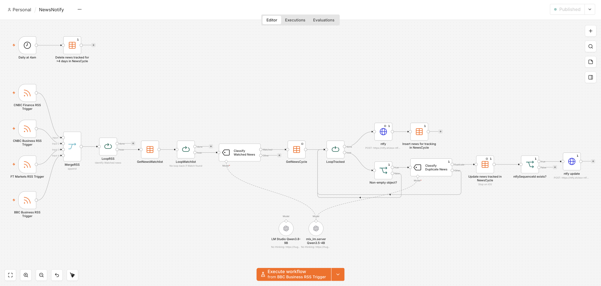

# NewsNotify

**AI-powered news monitoring and deduplication using n8n and a local LLM.**

NewsNotify monitors RSS feeds, uses a local Large Language Model (LLM) to identify news matching configurable topics, groups multiple reports of the same event, and delivers notifications through [ntfy](https://ntfy.sh/).

The project accompanies my article *[When Will the AI Bubble Pop?](https://www.pedrofreire.com/blog/when-will-ai-bubble-pop.html)*, which explores using changes in semiconductor manufacturing investments as potential early warning signals of an AI market correction.

## How It Works

1. **Collect news:** RSS feeds from CNBC, Financial Times and BBC are checked every 15 minutes.
2. **Identify relevant stories:** An LLM compares each article against topics defined in the `NewsWatchlist` data table.
3. **Detect duplicates:** A second LLM classification compares matching articles against previously reported events in the `NewsCycle` data table.
4. **Send notifications:** New events generate push notifications through ntfy. Subsequent reports about the same event update the notification and its collected news.
5. **Clean up:** A daily task removes tracked news older than four days.

The watchlist is configurable, so the workflow can monitor virtually any topic described in natural language.

## Technology

- [n8n](https://n8n.io/) — Workflow automation, RSS polling and data storage.
- [MLX-LM](https://github.com/ml-explore/mlx-lm) — Local LLM inference on Apple silicon.
- [Qwen 3.5 4B](https://huggingface.co/inferencerlabs/Qwen3.5-4B-LM-MLX-Q4) — Small language model used for news classification and event deduplication.
- [ntfy](https://ntfy.sh/) — Push notifications.

The workflow runs on a **MacBook Pro M1 with 16 GB of unified memory**, using a
4-bit quantized Qwen 3.5 4B model served through `mlx_lm.server`.
With "thinking off", each Text Classification operation involving the LLM takes
between 2 and 5 seconds.

No cloud-based LLM service is required.

## Repository Contents

| File | Description |
|---|---|
| `NewsNotify.json` | n8n workflow export |
| `NewsWatchlist.csv` | Example watchlist, including memory manufacturer investment monitoring |
| `NewsCycle.csv` | Data table structure for tracking news events |
| `screenshot.png` | Screenshot of the complete workflow |

## Installation

1. Install [n8n](https://docs.n8n.io/hosting/) and import `NewsNotify.json`.
2. Create two n8n Data Tables named `NewsWatchlist` and `NewsCycle`, using the supplied CSV files.
3. Update the workflow's Data Table nodes to reference your new tables.
4. Configure an OpenAI-compatible LLM endpoint in n8n. The supplied workflow uses a local MLX server running Qwen3.5-4B.
5. Configure ntfy authentication and replace `https://ntfy.sh/my-topic` with your notification topic.
6. Review the RSS feeds, polling intervals and watchlist definitions.
7. Activate the workflow.

The JSON export also contains an unused LM Studio model configuration, which can be removed or used as an alternative to MLX.

## Limitations

LLM classifications are probabilistic, even with temperature set to zero. News summaries may lack important context, relevant articles may be missed, and different events may occasionally be grouped incorrectly.

The workflow is an experimental news-monitoring tool, **not a financial prediction system**.

## License

Apache 2.0 License.
